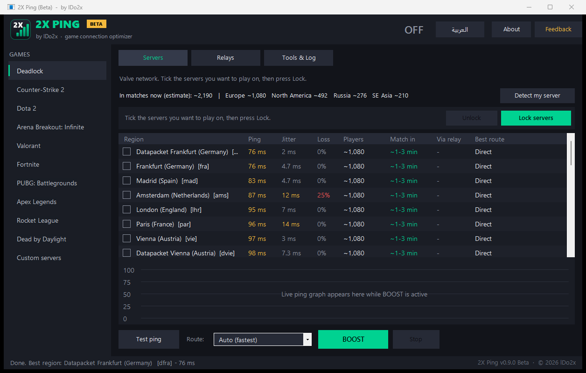

<p align="center"></p>

<h1 align="center">2X Ping</h1>

<p align="center">
<b>Lower ping, faster queues.</b><br>
Tests your game's servers in seconds, tells you where to play, and locks you to the server you want.<br>
Made by <b>lDo2x</b>
</p>

<p align="center">
<a href="../../releases"></a>
<a href="../../releases"></a>


<a href="README.md"></a>
</p>

<p align="center"><a href="../../releases"><b>⬇️ Download the latest version</b></a> · <a href="docs/2XPing-Guide-AR.pdf"><b>📖 Guide (PDF, Arabic)</b></a></p>

> [!WARNING]
> **Beta version.** 2X Ping is still in development: expect bugs, and features may change.
> Please report problems in [Issues](../../issues).

<p align="center"></p>

## Download

1. Open [Releases](../../releases) and download the latest `2XPing-v...zip`.
2. Extract it and run `2XPing.exe` (it asks for administrator rights).
3. If **"Windows protected your PC"** appears, click **More info → Run anyway**. The warning appears because this free app is not code-signed yet.

Requires **Windows 10 or 11**. Nothing to install, and after that updates are one click inside the app.

## Features

| Feature | What it does |
|---|---|
| ✦ Where do you want to play? | One card shows your regions with ping, wait time and players; **Play in ...** locks you to them |
| 📶 Ping test | Every region in 2-3 seconds; the Advanced layout adds jitter and packet loss per server |
| 🔒 Region lock | **Deadlock** (and **Overwatch 2** and **Dead by Daylight**, in development: they work, still being tested): pick your regions and lock out the rest |
| 🧭 Smart Deadlock lock | Knows your shortest way into Valve's network (for example through Dubai), and tells you before you lock if the lock would raise your ping, and by how much |
| ✅ Where am I playing? | While you're in a match, the card says which region you're on and whether it's one you picked |
| 👥 Player numbers | Estimated players per region and expected time to find a match (Deadlock) |
| 🛠️ Finds problems by itself | Errors (like landing on a server outside your lock) reach us automatically, without interrupting you |
| 🎛️ Your way | Pick your games on first launch; Simple layout for everyday players, Advanced with every tool |
| 🕒 In the taskbar | Minimize it while you play: the lock keeps working, hovering its taskbar button shows your live ping, and important notices flash it |
| 🪶 Light | Open and idle it uses about 56 KB of internet an hour; while you're in the game it stays quiet and the automatic check waits until you come back |
| 💬 No annoying popups | Notices show up like game-chat lines and fade out by themselves |
| ⚡ One-click updates | Downloads the new version, checks its SHA256 and reopens in seconds |
| 🚀 Relay speed-up (Advanced) | Routes only the game's connection through your own VPS when that path is faster |
| 🌐 Arabic & English | Full right-to-left Arabic interface |

### Supported games
Deadlock · Arena Breakout: Infinite · Overwatch 2 (in development) · Dead by Daylight (in development)

Deadlock is the main and best-supported game. Overwatch 2 and Dead by Daylight carry an "in development" tag: their lock works but is still being tested.

Other games (CS2, Dota 2, Valorant, Fortnite, PUBG, Apex, Rocket League) are being tested and will be added once they are verified.

## How to use

- **Pick where to play:** choose a game and every region is tested in 2-3 seconds (if the game is already open you see last time's results; press **Test ping** to refresh). Green is great (under 60 ms), yellow is OK, red is high. Tick one or more regions on the card and press **Play in ...**. **Other regions** shows more, and **Pick by hand** opens the full server list.
- **Then:** restart the game if it's open, and queue. Minimize 2X Ping while you play; it stays in the taskbar. 2X Ping blocks the game's other regions in Windows Firewall (login, voice chat and practice are untouched). The lock is removed when you press **Unlock** or close the app.
- **Deadlock:** the lock follows your shortest way into Valve's network. A player in the Gulf, for example, enters through Dubai and reaches Europe faster. If a lock has to close a way like that, the card tells you your new ping before you press the button. **Dubai** hosts SE Asia matches and is also the Gulf's shortest way to Europe: a lock that doesn't pick SE Asia (Europe, North America...) keeps it open for a lower ping, so sometimes a match may land there (2X Ping tells you). Turn off **Dubai as a way to Europe** in Settings to block Dubai unless you pick SE Asia. **Russia** is its own queue played on the European servers, so the lock can't choose it.
- **Where am I playing?:** join a real match (not practice) and come back to 2X Ping: the card says "You're playing in Europe now ✓", or warns you if the game put you somewhere else. It checks by itself while the game runs and you're looking at 2X Ping. In the Advanced layout, **Which server am I on?** watches the game's connection for 15 seconds and names the server. For other games it saves the server it finds.
- **Exact Deadlock server:** when the game enters Valve's network through a relay (like Dubai), the match server itself can't be seen. In Steam: Deadlock → Properties → Launch options, add `-condebug`, then restart the game. 2X Ping then reads the game's console log and names the exact city (for example Frankfurt).
- **Relay speed-up (optional):**
  1. Rent an Ubuntu VPS near the game servers and run `sudo bash setup-relay.sh` on it.
  2. Install [WireGuard for Windows](https://www.wireguard.com/install/).
  3. Switch to the **Advanced** layout in **Settings**, then add the printed `client.conf` under **Relays**.
  4. Leave the route on **Auto** and press **Speed up**.

## Notes
- Player numbers and match times are **estimates** based on public data.
- **Updates are required during the beta:** when a new version is out a bar appears, and you have 3 days to update with one click. After that the old version stops until you update.
- **Beta statistics:** while open, the app sends the name you enter on first launch, your computer's name, your city, country and internet provider, your PC's hardware and setup, the game, server and ping you use, ping-test results, which features you use, and error logs, to improve the beta. You are told on first launch and accepting is required to use the beta. Details in [SECURITY.md](SECURITY.md).
- 2X Ping **never changes game files or touches game memory** (the only game file it reads is Deadlock's console log, if you turned on `-condebug`). Everything it changes (firewall rules, tunnel) is undone when you stop it or close the app. See [SECURITY.md](SECURITY.md).
- Some games have their own anti-cheat policies; use the app at your own risk.

## Build from source
```powershell
powershell -ExecutionPolicy Bypass -File build.ps1            # dist\2XPing.exe
powershell -ExecutionPolicy Bypass -File build.ps1 -Release   # release\2XPing-v<version>.zip
```
Uses the C# compiler that ships with Windows (.NET Framework 4.8), so there is nothing to install.

## 🧪 Beta program: how to help
1. Try 2X Ping with your favourite game.
2. In the app press **Feedback** to report a bug or suggest an idea.
3. **Copy diagnostic info** copies your version and recent log (no personal data). Paste it into your report.

What's next: [ROADMAP.md](ROADMAP.md)

### Known issues
- Windows shows a SmartScreen warning because the app is not code-signed yet.
- Region lock has no effect if Windows Firewall is off or replaced by another security suite.
- 2X Ping only sees your server while you are **inside** a match or raid (not the menu or practice).
- In Deadlock, when the game enters through a relay (like Dubai), the match server can't be seen without `-condebug`.
- Per-region player numbers exist for Deadlock only; other games show the Steam total.
- In Overwatch 2 and Dead by Daylight (in development) the lock works for casual matches; ranked may still put you on your home region.
- In Overwatch 2 a lock only works inside your game's region (Americas, Europe or Asia, as set in the game); 2X Ping warns you before you lock outside it.

## 💬 Contact
| Channel | For |
|---|---|
| [Issues](../../issues/new/choose) | Bug reports |
| [Discussions](../../discussions) | Questions, ideas, new game requests |
| Discord: **`2x.x`** | Talk to the developer |

Contributing: [CONTRIBUTING.md](CONTRIBUTING.md) · Security & privacy: [SECURITY.md](SECURITY.md)

## License
[MIT](LICENSE) © 2026 **lDo2x**. Free and open source; keep the copyright notice when you reuse it.

Font: [Readex Pro](https://fonts.google.com/specimen/Readex+Pro), [SIL Open Font License](assets/fonts/OFL.txt).

<sub>2X Ping is an independent project, not affiliated with Valve, Tencent or any game company. Game names are trademarks of their owners.</sub>
