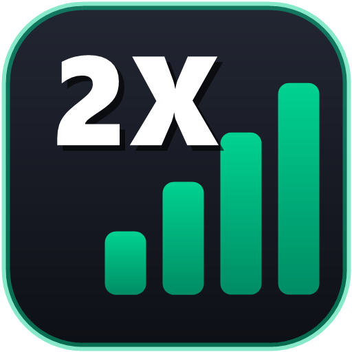
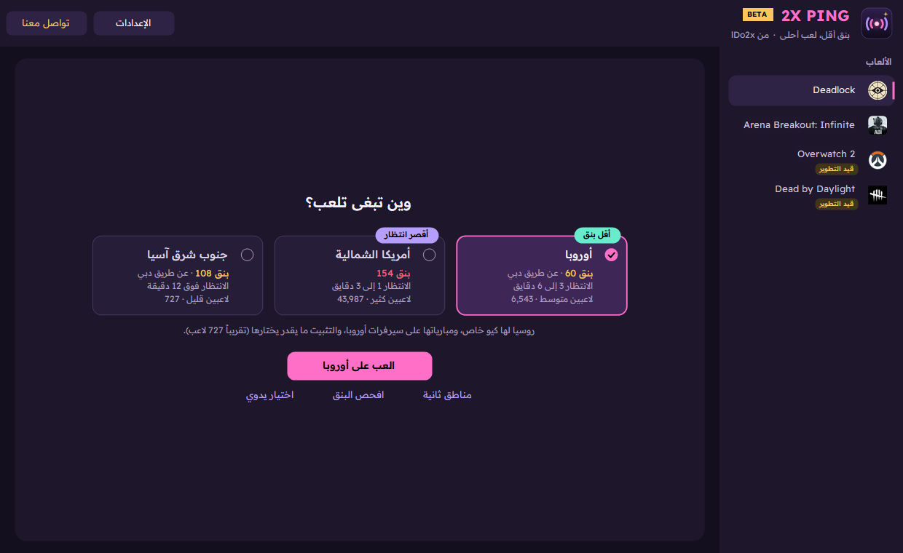

<div dir="rtl">

<p align="center"></p>

<h1 align="center">2X Ping</h1>

<p align="center">
<b>بنق أقل، بحث أسرع.</b><br>
يفحص سيرفرات لعبتك في ثواني، ويقولك وين تلعب، ويثبّتك على السيرفر اللي تبغاه.<br>
من تطوير <b>lDo2x</b>
</p>

<p align="center">
<a href="../../releases"></a>
<a href="../../releases"></a>


<a href="README.en.md"></a>
</p>

<p align="center"><a href="../../releases"><b>⬇️ حمّل آخر نسخة</b></a> · <a href="docs/2XPing-Guide-AR.pdf"><b>📖 الدليل (PDF)</b></a> · <a href="docs/2XPing-Slides-AR.pdf"><b>🖼️ العرض</b></a></p>

> [!WARNING]
> **نسخة تجريبية (Beta).** البرنامج لسا تحت التطوير: ممكن تواجه أخطاء، والمميزات ممكن تتغيّر.
> إذا لقيت مشكلة بلّغ عنها من [Issues](../../issues).

<p align="center"></p>

## التحميل

1. ادخل [صفحة الإصدارات (Releases)](../../releases) ونزّل آخر ملف `2XPing-v...zip`.
2. فك الضغط وشغّل `2XPing.exe` (يطلب صلاحية Admin).
3. إذا طلع لك **"Windows protected your PC"** اضغط **More info** ثم **Run anyway**. التنبيه يطلع لأن البرنامج مجاني وغير موقّع رقمياً.

يحتاج **Windows 10 أو 11** فقط، وما يحتاج تثبّت أي شي. وبعد كذا التحديثات بضغطة وحدة من داخل البرنامج.

## المميزات

| الميزة | الوصف |
|---|---|
| ✦ وين تبغى تلعب؟ | بطاقة وحدة تعرض لك المناطق بالبنق ووقت الانتظار وعدد اللاعبين، وزر «العب على ...» يثبّتك عليها |
| 📶 افحص البنق | بنق كل منطقة في ثانيتين ثلاث، وفي الوضع المتقدم التذبذب والفقد لكل سيرفر |
| 🔒 تثبيت السيرفرات | في **Deadlock** (و**Overwatch 2** و**Dead by Daylight** قيد التطوير: شغّالين، بس لسا نختبرهم): تختار المناطق اللي تبغاها، والباقي ينحجب |
| 🧭 تثبيت ذكي في Deadlock | يعرف أقصر طريق لك لشبكة Valve (مثلاً عن طريق دبي)، ولو التثبيت بيرفع بنقك يقولك كم قبل ما تثبّت |
| ✅ وين أنا دحين؟ | وإنت داخل المباراة، البطاقة تقولك على أي منطقة إنت، وهل هي من اختيارك |
| 🛠️ يكتشف المشاكل لحاله | لو صار خطأ (زي إنك طحت على سيرفر برا اختيارك) يوصلنا تلقائي بدون ما يقاطعك |
| 👥 عدد اللاعبين | كم لاعب في كل منطقة تقريباً، وكم بتستنى عشان تلقى مباراة (Deadlock) |
| 🕒 في شريط المهام | صغّره وإنت تلعب: يبقى في شريط المهام والتثبيت شغّال، وتشوف بنقك لما تحط الماوس على زره، ويومض لو في تنبيه مهم |
| 🪶 خفيف | وهو مفتوح وما تستخدمه يصرف تقريباً 56KB نت بالساعة، ولما تكون داخل اللعبة يهدى: الفحص التلقائي يوقف لين ترجع له |
| 💬 بدون نوافذ مزعجة | التنبيهات تطلع زي رسائل الشات في الألعاب وتختفي لحالها |
| ⚡ تحديث بضغطة | ينزّل النسخة الجديدة ويتأكد من بصمتها ويفتح من جديد في كم ثانية |
| 🚀 تسريع عن طريق وسيط | في الوضع المتقدم: اتصال اللعبة بس يمشي من سيرفر VPS حقك لو طلع أسرع |
| 🎛️ على كيفك | تختار ألعابك من أول مرة، والوضع البسيط للاعب العادي، والمتقدم فيه كل الأدوات |
| 🌐 عربي وإنجليزي | العربي هو الأساس، وتقدر تبدّل من الإعدادات |

### الألعاب المدعومة
Deadlock · Arena Breakout: Infinite · Overwatch 2 (قيد التطوير) · Dead by Daylight (قيد التطوير)

Deadlock هي اللعبة الأساسية وأحسن وحدة مدعومة. أوفرواتش وديد باي دايلايت عليها شارة «قيد التطوير»: التثبيت فيها شغّال، بس لسا نختبره.

الألعاب الثانية (CS2، Dota 2، Valorant، Fortnite، PUBG، Apex، Rocket League) نختبرها، وتنضاف لما نتأكد إنها تشتغل صح.

## طريقة الاستخدام

### وين تبغى تلعب؟
1. اختار لعبتك من القائمة، والبرنامج يفحص البنق لحاله في ثانيتين ثلاث. (لو اللعبة مفتوحة يوريك نتيجة آخر مرة، واضغط **افحص البنق** عشان تحدّثها.)
2. البطاقة تعرض لك المناطق مع البنق ووقت الانتظار وعدد اللاعبين. الأخضر ممتاز (أقل من 60ms)، والأصفر متوسط، والأحمر عالي.
3. علّم المنطقة اللي تبغاها (تقدر تختار أكثر من وحدة)، واضغط **العب على ...**. تبغى غيرها؟ اضغط **مناطق ثانية**، أو **اختيار يدوي** عشان تشوف كل السيرفرات.
4. لو اللعبة مفتوحة اقفلها وافتحها من جديد، وبعدين دوّر مباراة.
5. وإنت تلعب صغّر البرنامج: يبقى في شريط المهام والتثبيت شغّال.

البرنامج يحجب سيرفرات اللعبة في المناطق الثانية عن طريق جدار حماية ويندوز (الدخول والشات الصوتي والتدريب ما يتأثرون). التثبيت ينشال لما تضغط **فك التثبيت** أو تقفل البرنامج.

في **Deadlock** التثبيت يحسب أقصر طريق لك لشبكة Valve: لاعب في الخليج مثلاً يدخل الشبكة من دبي ويوصل أوروبا أسرع. لو التثبيت لازم يقفل طريق زي كذا، البطاقة تقولك كم بيصير بنقك قبل ما تضغط.
**دبي** في Deadlock تستضيف مباريات جنوب شرق آسيا، وهي كمان أقصر طريق للخليج لأوروبا. لما تثبّت على منطقة غير جنوب شرق آسيا (أوروبا، أمريكا الشمالية...) نخليها مفتوحة عشان بنقك يكون أقل (وأحياناً ممكن تطلع لك مباراة فيها، والبرنامج ينبهك). ما تبغى هادا؟ من **الإعدادات** طفّي «دبي كطريق لأوروبا»: دبي تنقفل إلا لو اخترت جنوب شرق آسيا.
**روسيا** في Deadlock لها كيو خاص، ومبارياتها على سيرفرات أوروبا، فالتثبيت ما يقدر يختارها.

### وين أنا دحين؟
بعد التثبيت، ادخل مباراة حقيقية (مو التدريب) وارجع للبرنامج: البطاقة تقولك **«تلعب دحين في أوروبا ✓»**، أو تنبّهك لو اللعبة حطّتك على منطقة ثانية. البرنامج يشيّك لحاله كل ما تكون اللعبة شغّالة وإنت على نافذته.
في الوضع المتقدم في زر **على أي سيرفر أنا؟**: يراقب اتصال اللعبة 15 ثانية ويقولك اسم السيرفر.
وفي Arena Breakout، يطلّع لك عنوان السيرفر وموقعه ويحفظه في القائمة.

**تبغى نعرف سيرفر Deadlock بالضبط؟** لما اللعبة تدخل شبكة Valve من وسيط (زي دبي)، سيرفر المباراة نفسه ما يبان. في Steam: Deadlock ← الخصائص ← خيارات التشغيل، ضيف `-condebug` وبعدين اقفل اللعبة وافتحها. بعدها البرنامج يقرا سجل اللعبة ويعرف لك المدينة بالضبط (مثلاً فرانكفورت).

### تسريع عن طريق وسيط (اختياري، في الوضع المتقدم)
البنق ينزل فعلاً لما يمشي اتصال اللعبة من سيرفر وسيط طريقه أحسن من طريق شركة النت حقتك:
1. استأجر VPS بنظام Ubuntu قريب من سيرفر اللعبة.
2. شغّل عليه `sudo bash setup-relay.sh`.
3. ثبّت [WireGuard for Windows](https://www.wireguard.com/install/).
4. من **الإعدادات** حوّل للوضع **المتقدم**، وبعدين من تبويب **سيرفرات الوسيط** ضيف ملف `client.conf` اللي طلع لك.
5. خلّ الطريق على **تلقائي** واضغط **شغّل التسريع**.

## ملاحظات مهمة
- عدد اللاعبين ووقت المباراة **تقديرية**، مبنية على بيانات عامة.
- **التحديثات إجبارية في البيتا:** لما تنزل نسخة جديدة يطلع لك شريط فوق، وعندك 3 أيام تحدّث بضغطة وحدة. بعدها النسخة القديمة توقف لين تحدّث.
- **إحصائيات البيتا:** البرنامج يرسل وهو مفتوح اسمك (اللي تكتبه أول مرة) واسم جهازك ومدينتك ودولتك وشركة النت، ومواصفات جهازك، واللعبة والسيرفر والبنق ونتائج الفحص، وتقرير قصير عن كل مباراة (على أي سيرفر كانت، وبنق اللعبة نفسها، وهل كانت داخل التثبيت)، والأزرار اللي تستخدمها، وسجل الأخطاء، عشان نطوّره. ينقال لك هادا أول ما تفتحه، والموافقة شرط لاستخدام البيتا. التفاصيل في [SECURITY.md](SECURITY.md).
- البرنامج **ما يعدّل ملفات اللعبة ولا ذاكرتها** (الملف الوحيد اللي يقراه هو سجل Deadlock لو شغّلت `-condebug`). كل التغييرات (جدار الحماية، الوسيط) تنشال لما توقفها أو تقفل البرنامج. التفاصيل في [SECURITY.md](SECURITY.md).
- بعض الألعاب عندها أنظمة حماية (Anti-Cheat) لها سياساتها الخاصة، والاستخدام على مسؤوليتك.

## البناء من الكود
```powershell
powershell -ExecutionPolicy Bypass -File build.ps1            # dist\2XPing.exe
powershell -ExecutionPolicy Bypass -File build.ps1 -Release   # release\2XPing-v<version>.zip
```
يستخدم مترجم C# اللي جاي مع ويندوز (.NET Framework 4.8)، فما تحتاج تثبّت شي.

| المجلد | المحتوى |
|---|---|
| `src/` | كود البرنامج (C# WinForms) |
| `relay/` | سكربت تجهيز الوسيط على VPS |
| `assets/` | الشعار، وأيقونات الألعاب، وأعلام الدول، والخط |
| `tools/` | مولّد الشعار، وإعداد قاعدة الإحصائيات (Supabase) |
| `docs/` | الدليل والعرض (PDF و PowerPoint) والصور |
| `.github/` | البناء والنشر التلقائي ونماذج البلاغات |

## 🧪 برنامج البيتا: كيف تساعدنا
1. جرّب البرنامج على لعبتك المفضلة.
2. داخل البرنامج اضغط **تواصل معنا** فوق، ومنه تبلّغ عن مشكلة أو تقترح فكرة.
3. زر **انسخ معلومات التشخيص** ينسخ الإصدار والسجل بدون أي بيانات شخصية، الصقه في بلاغك.

وش جاي بعدين: [ROADMAP.md](ROADMAP.md)

### مشاكل معروفة
- ويندوز يطلّع تحذير SmartScreen لأن البرنامج مو موقّع رقمياً.
- تثبيت السيرفرات ما يشتغل لو جدار حماية ويندوز مطفي، أو عندك برنامج حماية ثاني بداله.
- البرنامج يعرف سيرفرك بس وإنت **داخل** مباراة أو رايد، مو في القائمة ولا التدريب.
- في Deadlock لما اللعبة تدخل شبكة Valve من وسيط (زي دبي)، سيرفر المباراة ما يبان إلا لو شغّلت `-condebug`.
- أرقام اللاعبين لكل منطقة متاحة لـ Deadlock فقط، وباقي الألعاب تعرض العدد الكلي من Steam.
- اللي عندهم 0.9.x ينزّلون آخر نسخة بيدهم مرة وحدة، ومن بعدها التحديثات بضغطة.
- في أوفرواتش وديد باي دايلايت (قيد التطوير) التثبيت يشتغل على المباريات العامة، أما الرانكد فممكن اللعبة تفرض سيرفر منطقتك.
- في أوفرواتش التثبيت يشتغل بس داخل منطقة لعبتك (أمريكا أو أوروبا أو آسيا، زي ما هي في إعدادات اللعبة)، والبرنامج ينبّهك قبل ما تثبّت برا منها.

## 💬 التواصل
| الطريقة | للي |
|---|---|
| [Issues](../../issues/new/choose) | البلاغ عن مشكلة |
| [Discussions](../../discussions) | الأسئلة والأفكار وطلب ألعاب جديدة |
| Discord: **`2x.x`** | تواصل مباشر مع المطوّر |

للمساهمة في الكود: [CONTRIBUTING.md](CONTRIBUTING.md). للأمان والخصوصية: [SECURITY.md](SECURITY.md).

## الرخصة
[MIT](LICENSE) © 2026 **lDo2x**: مجاني ومفتوح المصدر. تقدر تستخدمه وتعدّله، بشرط تحتفظ باسم المطوّر والرخصة.

الخط: [Readex Pro](https://fonts.google.com/specimen/Readex+Pro) برخصة [SIL Open Font License](assets/fonts/OFL.txt).

<sub>2X Ping مشروع مستقل وغير تابع لـ Valve أو Tencent أو أي شركة ألعاب. أسماء الألعاب علامات تجارية لأصحابها.</sub>

</div>
